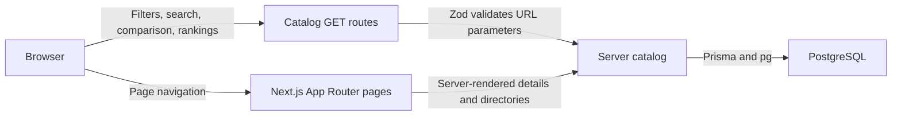

# OneAtlas

OneAtlas is a full-stack AI model catalog. It helps developers find models by capability, compare what providers charge, and interpret scores from individual benchmarks.

[GitHub repository](https://github.com/esubaleww/oneAtlas) · [Deployment guide](docs/DEPLOYMENT.md) · [Submission checklist](docs/SUBMISSION_CHECKLIST.md)

The public app URL is pending hosting sign-in and verification. The local demo runs on [localhost:3000](http://localhost:3000).

## Run locally

Use Node.js 24, npm, and Docker Desktop with the Linux engine running. From the repository root in PowerShell, install dependencies, initialize the local catalog, and start Next.js.

```powershell
npm ci
if (-not (Test-Path .env)) { Copy-Item .env.example .env }
docker compose up -d --wait db
npm run db:migrate
npm run db:seed
npm run dev
```

## Explore the demo

Search by model name or description, combine filters, and sort by release, context, or token rates. The URL preserves the active query and page across refresh and browser navigation. [Local model explorer](http://localhost:3000) · [Catalog API](docs/API.md)

Select a model name to open its specifications, provider rates, and benchmark results. The **Back to models** link restores the explorer query you opened it from. [Example model](http://localhost:3000/models/cedar-research-general)

Use **Labs** to browse model creators and their releases, or **Providers** to browse serving services and their offering prices. The search box in the header searches models, labs, and providers together. [Lab directory](http://localhost:3000/labs) · [Provider directory](http://localhost:3000/providers) · [Example global search](http://localhost:3000/search?q=compact)

Select two to four models using the **Compare** controls in the explorer or on model detail pages. Open the comparison from the tray to review specifications, provider rates, and benchmark results side by side. Add or remove models on the comparison page and use **Copy link** to share the current selection. [Example comparison](http://localhost:3000/compare?ids=cedar-research-general%2Ccedar-research-embed)

Open **Rankings** and choose a model category and benchmark. The page shows the benchmark’s scoring direction, methodology, and result sources. Equal scores share a rank, and the seeded scores appear in a dedicated demo leaderboard. Share the current selection by copying the page URL. [Example rankings](http://localhost:3000/rankings?category=TEXT_GENERATION&benchmark=demo-first-token-latency-v1)

### API examples

```powershell
curl.exe "http://localhost:3000/api/models?lab=cedar-research&provider=relay-cloud"
curl.exe "http://localhost:3000/api/compare?ids=cedar-research-general,cedar-research-embed"
curl.exe "http://localhost:3000/api/rankings?benchmark=demo-first-token-latency-v1&category=TEXT_GENERATION"
```

## Database configuration

| Variable | Used by |
| --- | --- |
| `DATABASE_URL` | Next.js runtime and the default migration and seed connection. The local value in `.env.example` points to Docker PostgreSQL on `127.0.0.1:5432`. Hosting uses the pooled database URL. |
| `DATABASE_URL_UNPOOLED` | Optional direct connection for `npm run db:migrate` and `npm run db:seed` when the runtime URL is pooled. |

If you already have an `.env`, confirm that `DATABASE_URL` selects the database you intend to use. The Compose service keeps the catalog in a named volume. `docker compose stop db` stops the container and retains the catalog. [Hosted database setup](docs/DEPLOYMENT.md)

`npm ci` generates Prisma Client automatically. Run `npm run db:generate` after changing the schema, and use `npm run db:migrate:dev -- --name your_change` to create and apply a development migration. `npm run db:migrate` applies committed migrations.

### Catalog structure and demo data

- A lab creates models, and a model can have one offering per serving provider. Prices are nullable decimals in USD per million tokens in the demo, with separately stored input and output rates and offering context limits. A stored zero represents a free rate. `null` represents an unavailable or inapplicable rate.
- A model can have one result per versioned benchmark definition. Results include provenance and a demo flag. Benchmark definitions store the unit, protocol, model type, and score direction.
- Slugs identify labs, models, providers, and benchmark definitions across installs. An offering or result uses a pair of related slugs as its key. The seed validates the fixtures, inserts missing records in one transaction, and preserves existing rows across runs.
- The seed contains 30 fictional models across five labs and five providers, 40 offerings, three benchmark definitions, and 45 results. All fixture names, prices, limits, and scores are synthetic. The demo includes free rates, missing rates, different provider prices for the same model, and models without a benchmark result.

## Architecture



- `src/app/` contains the pages and route handlers. Interactive catalog screens fetch through the API. Model details and directory pages use the server catalog directly.
- `src/server/catalog.ts` owns filtering, pricing selection, rankings, and serialization. It sends decimal prices and benchmark values as strings and reads related results in the same database snapshot when consistency matters.
- `prisma/` contains the schema, migrations, and repeatable seed. Prisma Client is generated during installation.
- Comparison preserves model order in the URL. Both displayed rates come from one provider offering. Rankings use a single benchmark version and score direction, with independent ranks for demo and reported scores. Equal scores share a rank. [API rules and examples](docs/API.md)

The catalog is read-only and the shipped records are synthetic. A future import could add source-verified data and retain the original source URLs and measurement dates.

## Verify

```sh
npm run lint
npm run typecheck
npm run build
npm start
```

`typecheck` generates the App Router types before running TypeScript. `start` serves the production build. Visit `/` for the explorer and `/missing-page` for the 404 screen.

With the seeded database and app running, run `npm run test:catalog` to verify the catalog endpoints, global search, directory pages, comparisons, benchmark rankings, and HTTP 404 responses. [API contract and examples](docs/API.md)

For browser tests, keep Docker PostgreSQL running with the demo seed. Install Playwright’s pinned Chromium browser once, build the app, and run the suite.

```sh
npx playwright install chromium --only-shell
npm run build
npm run test:e2e
```

The browser runner starts the production build on port `3100`. Set `CATALOG_TEST_BASE_URL` to target an already running instance with the demo seed. The suite runs in desktop and mobile Chromium, with axe accessibility scans and a 320 px overflow check. Run `npm run test:e2e -- --project=mobile` for just the mobile project, or `npx playwright show-report` to review the last browser run. [Playwright accessibility testing](https://playwright.dev/docs/accessibility-testing)

Local verification passed with 16 HTTP tests, 12 browser tests, lint, type checking, and a production build. Applying the migration to an empty PostgreSQL database and running the seed twice produced identical data on the second run. [Verification log](docs/PROGRESS.md)

## Stack and project notes

- Node.js 24, Next.js 16.4.6 (App Router), and React 19.3.1.
- TypeScript 6.0.3, Tailwind CSS 4.3.5 with its PostCSS plugin, and ESLint 10.15.0 with the Next.js, React Hooks, and TypeScript plugins. The lockfile records the exact dependency tree.
- The development and build scripts use Next.js's Webpack option because the Turbopack CSS worker exited early on the Windows development machine. [Next.js CLI reference](https://nextjs.org/docs/app/api-reference/cli/next)
- PostgreSQL 18.7 and Prisma 7.10.1 with the Node.js PostgreSQL adapter. Prisma 7's self-hosted compatibility table lists PostgreSQL through major version 18. [Prisma supported databases](https://www.prisma.io/docs/orm/v7/reference/supported-databases)
- Zod 4.6.7 validates catalog requests.
- Geist 1.9.2 supplies locally served typography.
- Playwright 1.65.1 and axe 4.14.1 run the browser and accessibility checks.

See the [implementation plan](docs/IMPLEMENTATION_PLAN.md), [reference research](docs/RESEARCH.md), and [Loom walkthrough outline](docs/LOOM_OUTLINE.md).
